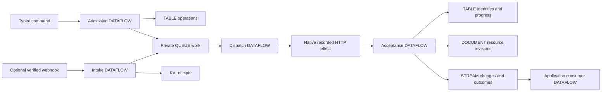

# Integration implementation plan

Status: **Proposed for review — 2026-11-19.**

Implement all 18 integrations as composable Transit programs. `DATAFLOW` owns
behavior, `QUEUE` owns durable work, `STREAM` owns committed observations and
outcomes, `TABLE` owns relational identity and integrity, `DOCUMENT` owns
versioned structured state, and `KV` owns point-addressed claims and context.
Consumers connect inputs and consume outputs; they do not run integration
workers or call a finishing method to advance accepted work.

This plan specifies implementation, not implemented support. No integration
source or runtime changes are included. The [milestone catalog](README.md)
retains its statuses and initial service scopes. The companion
[state and dataflow models](integration-state-models.md) apply this design
to every integration, including its first executable workflow and failure cases.

Implementation progress and the first blocking gate are recorded in
[execution requirements](../compiler-requirements.md). A source plan does not
override those measured compiler and runtime results.

## Source basis and executable boundary

The design follows `tpackages` at
`2e80f2ce3b7828844efc2c35fb7abcd43ad42a17`:

- [Dataflow and state plan](https://github.com/spoke-sh/tpackages/blob/2e80f2ce3b7828844efc2c35fb7abcd43ad42a17/docs/dataflow-refactor-plan.md): commands, automatic continuation, state ownership, and recovery.
- [Protocol contracts](https://github.com/spoke-sh/tpackages/blob/2e80f2ce3b7828844efc2c35fb7abcd43ad42a17/docs/application-protocol-contracts.md): recorded effects, mirrors, protected payloads, and native scheduling.
- [Target-language proposal](https://github.com/spoke-sh/tpackages/blob/2e80f2ce3b7828844efc2c35fb7abcd43ad42a17/docs/target-language.md) and [compiler ledger](https://github.com/spoke-sh/tpackages/blob/2e80f2ce3b7828844efc2c35fb7abcd43ad42a17/docs/compiler-requirements.md): distinguish authored source from executable qualification.

Resource semantics were reviewed in Transit at
`ff2bd9690765f33045f3156908ef538f7748b333`, particularly its
[data model](https://github.com/spoke-sh/transit/blob/ff2bd9690765f33045f3156908ef538f7748b333/docs/handbook/reference/data-model.md),
[Document SQL](https://github.com/spoke-sh/transit/blob/ff2bd9690765f33045f3156908ef538f7748b333/docs/handbook/reference/sql/create-document.md),
[KV SQL](https://github.com/spoke-sh/transit/blob/ff2bd9690765f33045f3156908ef538f7748b333/docs/handbook/reference/sql/create-kv.md),
[Stream/Queue operations](https://github.com/spoke-sh/transit/blob/ff2bd9690765f33045f3156908ef538f7748b333/docs/handbook/reference/sql/streaming.md),
and [connector effects](https://github.com/spoke-sh/transit/blob/ff2bd9690765f33045f3156908ef538f7748b333/docs/handbook/reference/connectors.md).

Those native/direct SQL surfaces are not equivalent to the compiled application
surface. This repository still pins Transit
`c1f2680d9353175e58ad503e750e7b4da76a84c5` and transitc
`61536eaa510e2ba8826c08b4f41072ed66f41ed5` in [flake.nix](../../flake.nix).
The recorded `tpackages` probes on those pins reject workspace and several
resource/dataflow constructs before exercising their bodies. No new probes were
executed for this documentation change. Native Document guarded reads do not
establish arbitrary Document writes in mixed transactions; published HTTP sinks
do not establish application dispatch. Audit each exact composition below.

Author the intended `.transit` model and record concrete upstream gaps, as
`tpackages` does. Keep source review, compiler acceptance, native execution,
and live provider verification separate. A matched known refusal is blocked
execution, never a successful integration test.

## Decisions proposed for review

1. Preserve the 18 independent roots and existing delivery order. Implement Stripe
   as the first complete dataflow slice, then GitHub to exercise OAuth composition.
2. Expose typed commands, result/change Streams, and authorized reads. Keep
   webhook ingress, synchronization, resource families, and Publications optional.
3. Use native durable effects and transactions throughout. Pure functions decode
   and validate; small atomic procedures only join a caller's transaction and
   share the command path's guards. They do not orchestrate network workflows.
4. Model structured provider state as versioned Documents with explicit schemas
   and bounded extension fields. Keep identities, relationships, uniqueness,
   searchable lifecycle state, and cursors in Tables.
5. Keep provider-specific operation/retry/sync semantics explicit. Reuse protocol
   packages where their contract matches; do not start with a generic CRM/mail
   engine or a universal HTTP-job interpreter.
6. Start required outcome/change history with explicit unlimited retention,
   as in `tpackages`, plus capacity admission limits and backpressure. Finite
   retention requires qualified checkpoint protection and a documented gap path.

## Public composition and package layout

Each public module receives stable instance/account bindings, selected resource
scope, typed policy, credential capabilities, and native effect/storage bindings.
Construction, grants, and activation are separate. Importing a module starts no
network requests, synchronization, webhook listener, or maintenance job.

Proposed public surfaces are connection/authentication bindings, independently
selected resource modules, `Sync`, `Webhooks`, authorized `Reads`, and optional
`Http`/`Publication` bindings. Exact provider names belong in each public entry.
A read-only resource selection must not instantiate writes or webhook intake.
Outlook mail/calendar and other optional resource families remain independent.

```text
integrations/<name>/
  build.transit                 selected public exports and build/test targets
  src/
    types.transit              typed commands, resource identities, outcomes
    state.transit              canonical resource declarations
    policy.transit             versioned policy and shared guards
    <resource>.transit         resource-specific commands and transitions
    effects.transit            native sink requests and response acceptance
    ingest.transit             authenticated change intake, when selected
    sync.transit               snapshot/change reconciliation, when selected
    reads.transit              current authorized query projections
    maintenance.transit        bounded native expiry/renewal/retention flows
    http.transit               optional source/response bindings
  tests/                       Transit contract, recovery, and boundary cases
  examples/                    application inputs, result consumers, activation
```

These are responsibilities, not mandatory empty files. Split resource modules
when selection requires it. Public exports must not eagerly import every source,
test, or example. Share protocols through pinned public `tpackages` entries;
do not import another integration's private files or require sibling checkouts.

Keep common semantics in typed ports and shared contract tests initially. Extract
reusable implementation only when two integrations demonstrate the same contract;
place protocol behavior in `tpackages` and runtime capabilities upstream. A shared
authentication principal or provider quota may be explicitly bound across module
instances without sharing their data or making unrelated integrations mandatory.

## Primitive ownership

Every mutable fact has one canonical owner. Query indexes/projections are derived
under the same acceptance decision or carry an explicit asynchronous source
revision; an asynchronous projection never authorizes a mutation.

| Primitive | Canonical use | Boundary |
| --- | --- | --- |
| `DATAFLOW` | Admission, authenticated intake, recorded dispatch, acceptance, reconciliation, renewal, cleanup, and required result consumption. | Triggered by native command, Queue, Stream, Source, or timer capabilities. Every transition names its input, read guards, writes, checkpoint/settlement, and failure path. |
| `TABLE` | Account/resource identity, relationships, operation ledger, uniqueness, selected query indexes, sync runs/cursors, and expiry indexes. | Native keys/constraints and guarded transactions enforce integrity. No JSON catch-all Table or Table-based lease/scheduler replacement. |
| `DOCUMENT` | Versioned connection policy, field mappings, schema snapshots, provider resource attributes, and selected content manifests. | Use the versioned profile, typed/bounded fields, and explicit revision guards. No automatic CRDT merge of provider state or policy. |
| `KV` | Verified delivery receipts, one-use validation context, coalesced refresh generations, and provider budget context where needed. | Point operations and conditional claims; no assumed scans, TTL service, or authority from knowing a key. Queue leases and Stream checkpoints remain native. |
| `QUEUE` | Finite fetch pages, object refreshes, selected writes, reconciliation, subscription renewal, and bounded transfer work. | Native leases, settlement, retries, delayed availability, and dead-letter policy. Entries carry original identity and references, not resolved credentials. |
| `STREAM` | Committed resource observations/changes, operation status transitions, synchronization progress, and declared subscription changes. | Typed immutable events with identity, source basis, per-key ordering, retention, and native consumer checkpoints. A Stream is not the job scheduler or canonical current row. |

Do not introduce a resource merely to use every primitive. For example, a pure
codec has no state, and a local atomic policy change needs no Queue. The provider
models specify meaningful uses of all six for the full integration profile.

### Shared logical records

The following names describe contracts, not fixed executable syntax:

- **Connection identity — Table:** stable instance, tenant/owner, provider origin,
  remote account, and credential capability reference. Remote account identity
  cannot change under an existing binding. Mutable settings live in the policy
  Document; secrets remain owned by the native secret/protocol capability.
- **Resource identity — Table:** `(instance, account, kind, remote_id)`, current
  Document revision reference, provider version/ETag where available, and
  visibility state. Relationships and uniqueness use constrained Tables.
- **Resource attributes — Document:** one typed provider representation, including
  explicit missing/null/unsupported fields and schema basis. Relational indexes
  refer to this revision; independently writable copies are forbidden.
- **Operation — Table:** logical operation ID, accepted actor, request commitment,
  target, policy/credential generation, native effect reference, phase, deadlines,
  reconciliation limits, and evidence. Client retry uniqueness is enforced here;
  do not keep a second competing operation-idempotency store in KV.
- **Sync position — Table:** collection/filter fingerprint, run generation,
  phase, accepted provider cursor reference, last complete run, and coverage.
  Large/sensitive opaque continuation values may use protected native storage;
  the Table retains the canonical reference. Native Stream offsets stay native.
- **Delivery receipt — KV:** authenticated provider delivery/event identity,
  connection, contract-defined payload commitment, accepted work reference, and
  eligibility bound. Distinguish delivery attempts from logical event identity.
  Compare the fields the provider promises are immutable; allowed redelivery
  metadata changes must not cause false conflicts. Conflicting immutable content
  refuses instead of becoming a successful duplicate. Preserve the original raw
  capture separately for signature verification and evidence.

Local Document revisions, provider ETags/versions, pagination tokens, sync tokens,
event IDs, and Stream positions are different types. Never compare opaque tokens
as timestamps or use a receipt as a resource authorization capability.

### Payloads and disclosure

Private typed Documents hold approved structured fields. Raw webhook bodies,
mail content, attachments, captured responses, and credential-bearing material
use protected native references or bounded blob storage with explicit purpose,
owner, and retention. Large bytes do not travel through ordinary Queue/Stream rows.
Public outcome/change Streams expose approved metadata and resource references,
not secrets or protected handles. Retain referenced Document revisions/payloads
for required consumers, or emit an explicit unavailable/gap outcome.

Apply current authority at admission, new dispatch, acceptance where required,
and disclosure. Revocation stops new effects and inappropriate reads without
erasing evidence of an already attempted operation. Background continuations
retain the accepted actor/account context; they do not borrow a service-wide
credential or arbitrary caller-supplied owner.

## Dataflow topology and transaction boundaries



Arrows describe dependencies, not separate uncoordinated writes. The following
are required native transaction boundaries. Network I/O occurs outside atomic
state transactions through the recorded effect owner.

| Transition | Native atomic acceptance |
| --- | --- |
| Command admission | Validate current policy and request commitment; insert/reuse operation identity, admit the private Queue continuation, and append an accepted outcome together. A repeated request with different content refuses. |
| Webhook intake | Verify raw bytes/signature and local endpoint binding before claiming identity. Commit receipt, protected payload retention, and durable refresh/work admission together. A successful HTTP acknowledgement follows commit. |
| Dispatch preparation | Guard operation phase, policy/credential generation, target, budget, and deadline; bind one immutable native attempt. An expired Queue lease cannot authorize another send. |
| Response acceptance | Match the original attempt/operation and check generation/authority; retain captured evidence, apply permitted canonical Table/Document updates, append permitted events, and settle the native input together. |
| Sync page acceptance | Verify run generation and expected cursor; commit page observations, indexes, next position/continuation, events, and input settlement together. Never advance beyond uncommitted page data. |
| Required Stream consumption | Commit the native input checkpoint with downstream state/output. A crash must not create a gap between application results and acknowledged progress. |
| Maintenance | Recheck canonical state/revision before renewal, expiry, or bounded deletion; preserve unresolved attempts and required-consumer evidence. |

Stale responses still retain the original private attempt evidence and settle the
input through a guarded decision; they cannot overwrite a newer projection or an
already accepted terminal outcome. Changed policy or credentials may prevent
materialization or disclosure, but cannot turn a remotely successful write into
an operation that was never dispatched. Reject and settle stale sync pages
without advancing current progress; do not leave them in an endless lease retry.

If the required mixed-resource transaction is unavailable, record a blocking
upstream requirement. Do not bridge it with a host poller, a second database,
best-effort dual writes, or a Table outbox masquerading as atomic Queue settlement.

### Operation and retry semantics

Admission returns an operation reference and current phase. Installed dataflows
advance accepted work; reading status is side-effect free. Results distinguish
accepted/pending, succeeded, refused before dispatch, failed with adequate
evidence, unknown remote outcome, and explicitly closed-unknown.

One logical operation can have multiple explicitly authorized attempts only when
its provider contract permits them. Native replay observes the original attempt;
it does not reconstruct a request with newer credentials, a new key, or a new
payload and send it again. Freeze request bytes/commitment and retain original
idempotency-key scope and validity. A 5xx, timeout, or cancelled local task does
not by itself prove the remote mutation failed.

Reconciliation is a separate bounded dataflow using captured evidence or an
authorized provider status/idempotency lookup. For unsafe creates/sends/appends
without definitive reconciliation, preserve unknown and stop automatic mutation
retries. Queue redelivery may resume observation but cannot independently permit
another remote attempt. Close exhausted/abandoned reconciliation explicitly;
late results cannot silently overwrite a closed outcome. Any further action is
a new deliberate operation, not deletion of the old receipt.

### Synchronization semantics

Provide two explicit profiles: provider change-token synchronization when the
selected API supplies it, and webhook hints plus bounded polling/reconciliation
otherwise. A REST list/search response is not automatically CDC or a snapshot.

1. Bind each run to account, collection, resource selection, filters, schema,
   authorization scope, and a new local generation. Guard every page against
   that generation and the expected continuation.
2. Keep last complete coverage separate from the run in progress. A fetched
   page may yield observed-resource events, but cannot advertise complete sync.
   Full replacement/resync uses staged generations and exposes completion only
   after the new generation is accepted; old content remains subject to current
   authorization and explicit stale/unavailable status.
3. Bound page and object fan-out through native Queues. Capture/accept each page
   before scheduling its successor; use expected revision or serialized per-key
   acceptance to keep stale responses from overwriting newer accepted state.
4. Advance provider sync tokens only after all changes they cover are committed.
   Keep within-run page tokens separate from the last complete sync cursor.
   Repeated/nonadvancing continuations refuse instead of looping indefinitely.
5. Treat verified webhooks as observations or refresh hints according to that
   provider's contract. Event arrival order does not establish resource version
   order. Deduplicate deliveries and re-read when event payloads cannot establish
   the current resource state.
6. Tombstone only on explicit provider deletion evidence or a qualified complete
   enumeration with stable coverage. Incomplete pages, narrowed permissions,
   filters, missing search results, or access-denied responses never prove remote
   deletion. Represent inaccessible, absent-in-selection, deleted, and unknown
   separately. Reconciliation sweeps themselves run in bounded resumable pages.
7. On invalid token or changed selection, start a fenced resync generation.
   Preserve operation/effect evidence and deduplication state. Resnapshotting
   observations must not recreate pending writes or resend historical messages.

### Scheduling, budgets, and retention

Native timers and delayed Queue availability drive refresh, backoff, subscription
renewal, and cleanup. Rate-limit fields from provider responses update typed
budget context under guarded acceptance; they are not arbitrary sleep commands.
Bind quotas at the provider's actual app/account/resource scope, including an
explicit shared budget where several instances use the same principal.

Every selected profile declares page, response-byte, decode/depth, transfer,
concurrency, retry, reconciliation-time, and retained-work bounds. Backpressure
refuses or defers admission visibly without losing required control progress.
Retry policy differs for reads, idempotent mutations, and unsafe writes; there
is no blanket HTTP retry setting.

Separate operation/effect evidence, webhook claims, protected payloads, required
Streams, and optional diagnostics. Initially required event history is retained
explicitly; capacity limits still apply. Deleting payloads cannot recycle an
operation identity or permit an old delivery to execute again. KV expiry is
checked logically; if native expiry traversal is unavailable, maintain only a
key/deadline Table index in the same transaction and clean it in bounded flows.
Native Queue leases and consumer assignment fencing are never reimplemented here.

## Protocol composition

| Integration profile | Candidate reuse and boundary |
| --- | --- |
| GitHub | `oauth-github` plus `oauth` for the chosen user authorization profile. Repository APIs and GitHub-native webhook verification stay here. |
| Google Drive / Calendar / Gmail | `oauth-google` plus `oauth`, with separate selected scopes and account bindings. No compulsory dependency between the three integrations. |
| Salesforce, HubSpot, Slack, Linear, Jira, GitLab, Notion, Microsoft, Airtable, Zendesk, Intercom, Shopify | Qualify the exact OAuth/token lifecycle against generic `oauth`; add protocol-specific provider adapters in `tpackages` only when required. No adapter is assumed to exist from its service name. |
| Stripe initial profile | Protected API-key binding. No OAuth dependency until a separately scoped profile requires it. |
| Webhooks | Use established native crypto and provider-specific raw-byte rules. Select `standard-webhooks` only for an actually matching wire profile; none of the initial providers is assumed to implement it. |
| Calendar/mail/file APIs | These are the providers' product APIs. `icalendar`, CalDAV, JMAP, or DAV are optional only for a concrete compatible interchange/profile; their presence does not supply recurrence expansion, Gmail submission, or Drive synchronization. |

All reuse depends on executable qualification, not just authored package source.
Credential refresh is consumed through the protocol's completion path; applications
do not copy token logic or drive a refresh/finish loop. Renewing authorization may
permit future attempts but cannot rewrite an existing attempt's identity.

## Delivery units

Keep the existing milestone order. The units below are reviewable implementation
changes, not new milestones or delivery dates. Each adds public exports, source,
examples, tests, evidence, and documentation together.

| Unit | Deliverables | Review/acceptance gate |
| --- | --- | --- |
| A. Shared contracts and probes | Types/ports for account binding, operations, observations, sync progress, policy, and native effects; resource ownership/schema diagrams; minimal compiler probes. | Every field has one owner and every transition names its atomic boundary. Record actual pin-specific results; no integration qualification inferred. |
| B. Stripe vertical slice | Customer/checkout commands, billing observation Documents, event receipts, durable Queues, automatic reconciliation, result Streams, and an application consumer. | End-to-end admission through provider evidence to committed output; duplicate delivery and lost-response/crash cases preserve one logical operation. |
| C. GitHub and protocol composition | GitHub resource/issue flows, qualified OAuth port, optional webhook binding, two account instances, and read-only selection. | No consumer finish loop; no token-bearing public event; correct access loss, unsafe-comment uncertainty, and selected dependency graph. |
| D. CRM profiles | Salesforce then HubSpot: versioned schemas/mappings, relational links, selected writes, and bounded sync. | Schema changes and partial batches cannot corrupt canonical state; no assumed universal CRM field model. |
| E. Team profiles | Slack, Linear, Jira, GitLab, using their [individual models](integration-state-models.md). | Thread/work-item identities, workflow constraints, GraphQL partial results, and provider-specific retry evidence remain explicit. |
| F. Knowledge/productivity profiles | Notion, Drive, Calendar, Gmail, Outlook, Teams, Airtable. | Bounded document/media handling, independent modules, token resets, notification renewal, and send uncertainty execute through native flows. |
| G. Support/commerce profiles | Zendesk, Intercom, Shopify. | Reply visibility, custom schemas, query-cost budgets, and webhook/resource reconciliation pass provider-specific tests. |
| H. Catalog qualification | Per-root and selected-pair consumers, offline builds, native installation/recovery, migration basis, provider evidence, and release matrix. | The [release milestone](20-consumer-qualification-and-releases.md) closes only for the qualified catalog; earlier subsets name their completed profiles. |

Within each provider, implement types/pure mappings and state declarations first,
then read/sync flows, write/reconciliation flows, optional ingress/publication,
and failure/consumer qualification. The first thin working workflow is mandatory;
do not spread untested HTTP wrappers across all 18 before reviewing Units B/C.
Source authoring may proceed through documented compiler blockers while executable
acceptance remains open.

## Native capability and compiler gates

Create a tintegrations probe/evidence ledger during Unit A, referencing the
existing `tpackages` requirements rather than claiming these new probes passed.
Each record needs the owning upstream, exact revisions/command, first diagnostic
or execution result, affected integrations, and a minimal acceptance case.

| Gate | Required evidence | Existing source basis |
| --- | --- | --- |
| Selection and composition | External pinned root, lazy resource selection, same-revision protocol dependencies, private state, typed exported ports. | TP-01–04 in the tpackages ledger. |
| Documents and relational integrity | Versioned row Document read/write guards, current-resource indexes, relationships, and atomic observation acceptance. Do not infer tree/CRDT support. | TP-10, TP-12, TP-14; native Document owner. |
| KV and maintenance | Conditional claim contention, revision checks, retained receipts, logical expiry, bounded cleanup, and native timer activation. | TP-11, TP-15. |
| Queues and Streams | Fenced input leases/checkpoints, delayed scheduling, atomic settlement with state/events, required-consumer retention, and replay. | TP-06, TP-12–13. |
| Commands, HTTP, and effects | Native command/HTTP triggers, protected request/response ownership, current authority, exact attempt capture/replay, and each required HTTP method/body type. JSON POST, PATCH/PUT/DELETE, GraphQL, and uploads need explicit profile checks. | TP-05–07, TP-16; native connector owner. |
| Content transfer | Bounded protected byte streams/blob references, verified complete publication, native resume/cleanup, and MIME/format primitives for selected profiles. | TP-17 and the selected native codec/transfer owners. |
| Testing and upgrades | Deterministic effect mocks at the native boundary, clock/fault controls, emitted SQL installation, source provenance, and actual prior-state migration. | TP-08–09 and provider-specific fixtures. |

Native support may exist below a missing source binding. Record that distinction
and extend the owning layer; do not label every later operation unsupported when
the compiler stopped at an earlier declaration. Never change a failing runtime
assertion into a tolerated parser gap.

## Validation and state evolution

Tests run the integration's real dataflows and state transitions; only external
effects are mocked at their native boundary. Assert values, authority, dispatch
counts, operation identities, retained evidence, and input progress.

| Test family | Required cases |
| --- | --- |
| Admission and authority | Same request/same payload, conflicting reuse, two accounts/tenants, denied action, stale policy/schema/secret generation, current disclosure after revocation. |
| Effects and recovery | Crash before/after admission, native attempt authorization, send, capture, state acceptance, output append, and input settlement; lost reply, late result, deadline, unknown closure, replay without network. |
| Sync and intake | Signature failure, duplicate/conflicting delivery, reordered refreshes, partial pages, nonadvancing cursor, token reset, changed filter/scope, false-deletion control, and bounded restartable sweep. |
| Streams and retention | Two independent consumers, replayed input, fenced old worker, lag/backpressure, required history protection, explicit optional-consumer gaps, and retained revision references. |
| Selection and reuse | Every root alone; read-only/core without ingress; two instances; Google services independently; Outlook mail/calendar independently; selected pairs with shared protocol pins; unrelated-source exclusion. |
| Provider verification | Exact API/authentication profile in a provider test environment where available; compare captures and failure behavior with fixtures. Keep credentials and external calls out of default checks. |

No existing service state has shipped. Preserve the first executable artifact as
the migration basis instead of fabricating old SQL. Future migrations preserve
instance/account identity, remote keys, protected references, outstanding native
attempts, operation commitments, delivery claims, sync generations, and Stream
positions. If in-flight work cannot resume under its original definition, refuse
that cutover or drain it explicitly; do not re-enqueue it as new work.

Completion requires both the [shared roadmap gates](README.md#shared-completion-gates)
and each [provider model](integration-state-models.md). Source-complete, blocked,
native-tested, and provider-verified are separate evidence states; milestone
statuses remain `Planned`, `In Progress`, or `Completed`.
